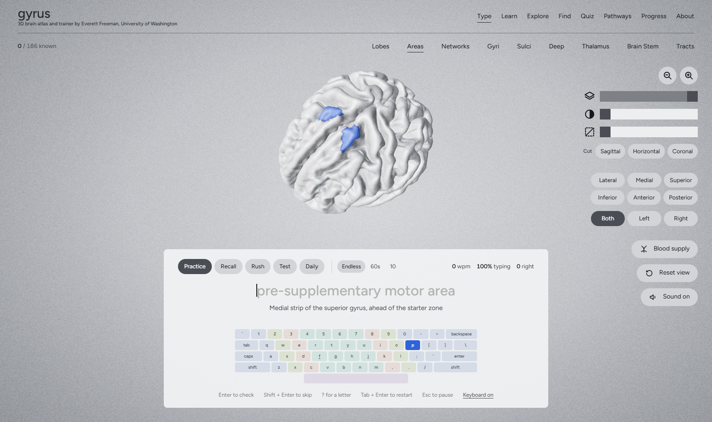

# gyrus

An interactive 3D atlas of the human brain that runs entirely in the browser. It combines cortical surface meshes, seven anatomical and functional parcellations, volumetric MRI, PET receptor maps and meta-analytic function maps in one WebGL viewer, with literature evidence for every region and a keyboard-first recall trainer.



| | |
|---|---|
| Regions | 186, each with structured content and evidence |
| Cortical mesh | fsaverage6, 81,924 vertices and 163,840 triangles, pial and inflated |
| Parcellations | Destrieux, HCP-MMP1.0, Yeo 7-network, Harvard-Oxford, AAL3, Julich, Pauli |
| Volumes | MNI152 2009 template at 1.5 mm with a co-registered structure label grid |
| Molecular maps | 16 PET receptor and transporter maps |
| Function search | 135 NeuroQuery terms scored across all 186 regions |
| Probability maps | 44 Julich cytoarchitectonic regions |
| Vascular | Johns Hopkins arterial atlas: 15 branch territories and watershed zones |
| Literature | 628 evidence and stimulation entries, 58 evidence items in two guided tours, 228 figures |
| Pathways | 12 signal pathways, 10 neurotransmitter systems, 2 evidence tours |

## Architecture

```
atlas sources (FreeSurfer, nilearn, NeuroQuery, PET, JHU)
        |  data/*.py: resample, label, mesh, score
        v
data/*.json + data/content + data/evidence + data/topics
        |  build.py: validate against PubMed, join, compress, inline
        v
dist/index.html (single file, about 9 MB) + dist/fig/*.webp
        |
        v
three.js renderer, custom shaders, BVH picking, typing engine
```

**Data pipeline (Python).** `build_meshes.py` builds the cortical surfaces, upsamples Destrieux labels from fsaverage5 to fsaverage6 and extracts 1 mm subcortical meshes. `build_more.py` adds the HCP, Yeo, Julich and Pauli layers. `build_extras.py` resamples the MNI template, the label grid, the probability maps and the vascular territories onto a common grid and computes NeuroQuery scores per region. `build_chem.py` surface-smooths the PET maps, scaling cortex and deep structures separately, and computes density by structure and by Yeo network.

**Evidence verification.** `build.py` runs every evidence entry through `tools/verify_evidence.py`. An entry must carry a PMID, a quotation that appears word for word in that PubMed record, a matching publication year, and only numbers that occur in the quotation. Entries that fail are dropped from the build.

**Renderer (JavaScript, three.js 0.160).** Vertex attributes carry the parcellation, sulcal depth and overlay values, and a morph between pial and inflated geometry exposes buried cortex. `three-mesh-bvh` proxies are refit to the inflated surface, which cut pick time from about 10.5 ms to 1.7 ms. Volumes are stored as gzip plus base64 inside the page and decoded with the browser's `DecompressionStream`, so the app needs no backend. A textured MRI plane stays synced to a 2D slice panel.

**Trainer.** Practice, Recall, Rush, Test, Daily (seeded by date and deck) and Find modes, with per-region recall tracking, words per minute computed over first-to-last keystroke, and separate typing and region accuracy.

## Build and run

```bash
python -X utf8 -I build.py              # validates evidence and writes dist/index.html
python -m http.server 8000 -d dist      # then open http://localhost:8000
```

The build reads cached PubMed records from `data/cache/pubmed`, so it runs offline and reproduces `dist/index.html` byte for byte. three.js and three-mesh-bvh load from a CDN at runtime.

## Testing

```bash
npm install
npx playwright-core install chromium webkit
python -X utf8 -I tools/qa_data.py      # regions, geometry, links, evidence, figures, tours
node tools/qa_run.js explore            # also: type, modes, find, paths, hover, misc, layout
node tools/qa_phone.js                  # phone layouts in Chromium and WebKit
```

The Playwright suites run about 4,900 checks across desktop and phone layouts, including selecting all 186 regions, typing every region name, opening every pathway and finding every region by click. Set `CHROMIUM_PATH` to use a specific Chromium build.

## Data sources

Destrieux et al. 2010 · Glasser et al. 2016 · Yeo et al. 2011 · Schaefer et al. 2018 · Harvard-Oxford atlas · Rolls et al. 2020 (AAL3) · Amunts et al. (Julich-Brain) · Pauli et al. 2018 · Fonov et al. 2011 (MNI152) · Dockès et al. 2020 (NeuroQuery) · Hansen et al. 2022 (PET receptor maps) · Liu et al. 2023 (arterial atlas)

Each source keeps its own license. Figures remain the property of their publishers and are credited in the app.

Built by Everett Freeman, University of Washington.
